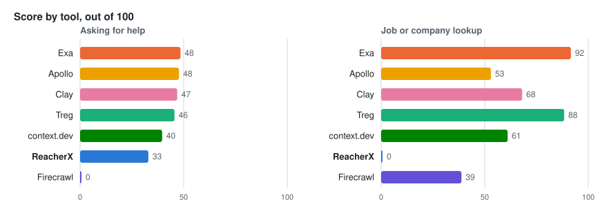
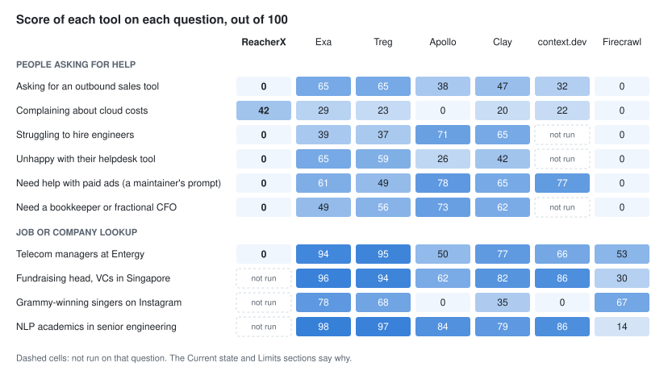
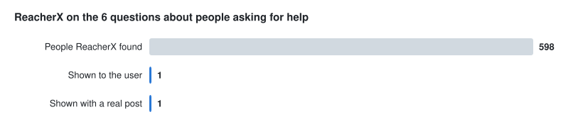
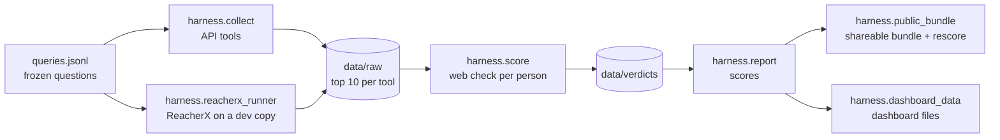

# People search benchmark

A small, repeatable test of how well ReacherX finds the right people, compared with six other
people-search tools: Apollo, Clay, Exa, Firecrawl, context.dev and Treg. Tracked in
[issue #122](https://github.com/VecterAI/reacher-x/issues/122).

Every tool gets the same questions. We keep the first 10 people each tool returns, check every
person on the web with an independent AI checker, and score the results with the scoring code of
[People Search Bench](https://github.com/LessieAI/people-search-bench) by LessieAI, unchanged.

**Results dashboard:** https://claude.ai/artifact/FqnVYgYFXevGgetd8jUTq7
(open it in a browser where you are signed in to Claude, otherwise it may look empty). It shows
the scores, every question's exact prompt, and every person each tool returned with links to the
evidence behind each grade.

## Results so far

Run on November 6 and 7, 2026. "Asking for help" questions look for people who publicly posted a
need, which is what ReacherX is built for. "Job or company lookup" questions come from the public
People Search Bench.

<picture>
  <source media="(prefers-color-scheme: dark)" srcset="docs/scores-dark.svg">
  
</picture>

| Tool              | Questions answered (help / lookup) | People with a real post | Cost per question | Time per question |
| ----------------- | ---------------------------------- | ----------------------- | ----------------- | ----------------- |
| Exa               | 6 / 4                              | 0                       | under 1 cent      | 3 sec             |
| Apollo (via Treg) | 6 / 4                              | 0                       | $0.16             | 9 sec             |
| Clay              | 6 / 4                              | 0                       | free plan         | 19 sec            |
| Treg              | 6 / 4                              | 0                       | under 1 cent      | 3 sec             |
| context.dev       | 3 / 4                              | 0                       | free plan         | 14 sec            |
| **ReacherX**      | **6 / 1**                          | **1**                   | $0.39             | 10 min            |
| Firecrawl         | 6 / 4                              | 0                       | free plan         | 10 sec            |

"People with a real post" counts people whose public post about the need the checker could
confirm. ReacherX's time comes from a development copy, which is slower than the live app.

<picture>
  <source media="(prefers-color-scheme: dark)" srcset="docs/questions-dark.svg">
  
</picture>

<picture>
  <source media="(prefers-color-scheme: dark)" srcset="docs/funnel-dark.svg">
  
</picture>

What the results show:

1. **Job and company lookups:** Exa and Treg are far ahead. ReacherX scored 0 on the one lookup it
   ran; it searches posts, not staff directories.
2. **People asking for help:** no tool does this reliably. Across all tools, one person had a real
   post, and ReacherX found them. But ReacherX showed nobody on 5 of the 6 questions, so its
   score of 33 comes almost entirely from that one person (see step 5 of How it works).
3. **The other tools' help scores come from job titles.** The standard score gives partial credit
   for a matching profile even without a post, so most tools reach 40 to 48 with no real posts.
4. **ReacherX's filter agreed with the checker.** The checker did not confirm a real post for any
   of the 59 top-ranked people ReacherX held back. But in round 1 the checker also saw
   ReacherX's own reasoning for these people (see [Limits](#limits)), so this is being re-checked
   blind. The open question is whether ReacherX can reach people who did post.

**What round 1 can't show.** ReacherX was measured on one search cycle. In production it runs in a
loop: after setup it runs up to 8 cycles 2 minutes apart, then a new cycle 60 minutes after each
one ends, widening its searches as it goes
([cycle timing](https://github.com/VecterAI/reacher-x/blob/main/convex/lib/runtimeConfigHelpers.ts),
[widening](https://github.com/VecterAI/reacher-x/blob/main/convex/lib/targetingSpecCore.ts)). The
test copy had that loop switched off.

**Next:** a one-question pilot on the live site, run for 24 hours under a plan locked publicly in
advance, scored by a blind checker whose grades are compared with human labels. It decides
whether a full run is worth doing. The draft plan is in the Current state tab of the results
dashboard.

## Current state

| Item                                                              | Status                                              |
| ----------------------------------------------------------------- | --------------------------------------------------- |
| 10 questions on every API tool (context.dev: 7 of 10, see below)  | Done, scored                                        |
| ReacherX on the 6 "asking for help" questions and 1 lookup        | Done, scored                                        |
| ReacherX on the other 3 lookups                                   | Not run (see [Limits](#limits))                     |
| context.dev on 3 of the newest questions                          | Waiting for its free credits to reset on December 4 |
| Short one-line versions of 4 questions (`int_0007` to `int_0010`) | Written, not run yet                                |
| Hand-check of a sample of the checker's grades                    | Not done yet                                        |
| Blind checker (no tool's own score or reasoning)                  | Fixed in code; re-check of 131 people pending       |
| 24-hour pilot on the live site                                    | Proposed, waiting on approval                       |

## How it works



1. **Questions.** `queries.jsonl` holds the frozen questions:
   - 4 job or company lookups drawn at random from People Search Bench's 119 questions, one per
     category (random seed 122). Track `public`.
   - 6 questions about people publicly asking for help, written for this test (track `intent`).
     One of them is a prompt a ReacherX maintainer uses.
   - Short one-line versions of 4 of those (track `intent_short`). Each has `grade_as`, the id of
     its detailed twin, and is graded against the twin's criteria, so a vague prompt is judged on
     what the user really wanted.
2. **Collecting results.** Every tool gets the same prompt text.
   - Exa, Treg and context.dev take the text directly. Firecrawl searches the web with it, and an
     AI model takes one person from each page it returns.
   - Apollo and Clay only take filters, so an AI model turns the prompt into filters, with one
     automatic retry when nothing comes back or Clay rejects a filter value.
   - ReacherX runs through the app's normal setup on a development copy (see below). Its result is
     the people it chose to show.
3. **Web check.** Gemini 3.1 Flash-Lite checks each person with up to 2 Tavily web searches and
   marks each part of the prompt as met, partly met or not met, with evidence. Each prompt is split
   into parts once, and every tool is judged against the same parts. The checker sees who the
   person is and the posts each tool cites, never a tool's own score or reasoning.
4. **Scoring.** People Search Bench's code at a pinned commit: the average of ranking (padded
   nDCG@10), coverage and usefulness, out of 100. A person counts as a good fit at a web check of
   0.5 or more. On top of that we count **real posts**: a person counts only if the checker
   confirmed every part about the post (posted publicly, on or after the date, about the need).
5. **Reporting.** A question a tool hasn't been run on is left out of that tool's score, not
   counted as zero. A run that returned nobody scores 0 on that question, and counts as 0 for
   ranking and coverage in the tool's overall score. People Search Bench averages usefulness
   only over questions where the tool returned someone, so ReacherX's help score of 33 rests on
   the one person it showed: ranking 3.7, coverage 0.3, usefulness 95.

`config.json` records the full method: models, per-tool settings, questions not run with the
reason, and every change from the standard benchmark.

## Changes from the standard People Search Bench

- 10 questions instead of 119, and the top 10 people instead of 15.
- Basic web search with at most 2 searches per person, to fit a free search quota.
- Each prompt is split into parts once and shared by all tools.
- Gemini 3.1 Flash-Lite as the checker instead of the default model, to fit the budget.
- The "asking for help" questions and the real-post count were added for this test.
- A second ReacherX view, its top 10 by match score including people it held back, was added
  after the first results. The main comparison uses what ReacherX shows.

## Limits

- ReacherX was measured on one search cycle, its strictest. In production it keeps searching
  about every hour.
- In round 1 the checker wasn't fully blind: for ReacherX's people it also saw ReacherX's own
  match score and reasoning, and for context.dev's people that tool's own confidence score. The
  code now hides them. Those 131 people haven't been re-checked yet, so round 1's numbers for
  ReacherX and context.dev may still move.
- Small test. A gap of a few points between two tools doesn't mean much.
- The checker is an AI model and can be wrong. Its grades haven't been hand-checked yet.
- Two basic web searches per person can miss a real post, so real posts may be undercounted for
  every tool.
- The "asking for help" questions were written for ReacherX's use case, which may favour it.
- ReacherX ran on a development copy, and nobody adjusted its setup after the preview, which a
  real user could do.
- ReacherX skipped 3 lookups: recruiting (its LinkedIn data credits ran out mid-run), Instagram (it
  searches X and LinkedIn only) and AI researchers (credits were kept for the "asking for help"
  questions).
- On the cloud-cost question, 60 people ReacherX found on X were never checked because its X data
  balance ran out.
- Prices come from free plans where a tool offers one, so they understate paid prices.
- Scores aren't comparable with the public People Search Bench leaderboard.

## Reproduce it

Needs [uv](https://docs.astral.sh/uv/) and a `.env.benchmark.local` at the repo root with the
keys you need: `OPENROUTER_API_KEY`, `TAVILY_API_KEY`, `EXA_API_KEY`, `FIRECRAWL_API_KEY`,
`CONTEXT_DEV_API_KEY`, `CLAY_API_KEY`, `TREG_TOKEN`, `TREG_TOKEN_REACHERX`.

```bash
cd benchmarks/people-search
# The 10 published questions. Add int_0007,int_0008,int_0009,int_0010 to also run the short prompts.
QUERIES=b2b_0014,rec_0020,inf_0028,det_0010,int_0001,int_0002,int_0003,int_0004,int_0005,int_0006
uv run python -m harness.collect --queries $QUERIES     # top 10 from each API tool
# ReacherX: one paid run per question (see "ReacherX runs" below)
uv run python -m harness.reacherx_runner --query int_0005 --user-id <dev users _id> --credit-cap 100
uv run python -m harness.collect --tools reacherx,reacherx_topfit
uv run python -m harness.score --judge final            # web check for every person
uv run python -m harness.report --judge final           # results table, no keys needed
uv run python -m harness.public_bundle                  # shareable bundle (no emails or phones)
uv run python -m harness.public_bundle --rescore        # recompute every score from the bundle, no keys
uv run python -m harness.dashboard_data --judge final   # data files for the results dashboard
uv run python -m harness.readme_charts --judge final    # the charts in this README
```

Every answer, web search and verdict is cached under `data/`, so a rerun never pays twice.
`data/` is git-ignored because it holds personal data.

### ReacherX runs

- The runner only targets a Convex **dev** deployment, through internal functions in
  `convex/benchmarkPeopleSearch.ts`.
- It turns `PAUSE_AUTONOMOUS_JOBS` off for the run and always puts back the value it had before.
- When the run ends it stops the run, deletes the SocialAPI monitors it created and deletes the
  benchmark workspace. Deletion only goes ahead for the workspace this run created (exact name and
  a creation time inside the run window).
- If stopping fails or a monitor can't be deleted, the runner keeps the workspace, prints a
  warning and exits with code 3. Monitors may then still be live at SocialAPI. Before restoring
  the SocialAPI key, rerun the stop from `benchmarks/people-search` until it reports no monitor
  failures, then delete the workspace from the app. This goes through the runner's helper, so it
  only ever targets the validated dev deployment:

  ```bash
  uv run python -c 'import json; from harness.core import convex_cli; print(convex_cli("run", "benchmarkPeopleSearch:stopRun", json.dumps({"workspaceId": "<id>"})).stdout)'
  ```

- It stops early at a LinkdAPI credit cap (`--credit-cap`). A failed status read is retried on the
  next poll, and the run is given up after 3 failed reads in a row. If the spend, the account
  balance or the credit count can't be read, the run stops at once, since an unread cap can't be
  enforced.
- `harness.provider_key` swaps the dev LinkdAPI or SocialAPI key for a run and restores it:
  `uv run python -m harness.provider_key <linkdapi|socialapi|all> <status|use-prod|restore>`.
  It prints key fingerprints, never keys. Restore SocialAPI only after the run has deleted its
  monitors, since monitors belong to the account whose key created them.

### Spend guards

Before every paid step the harness checks that:

- the OpenRouter account balance covers the step,
- total spend stays below $9.50, and
- OpenRouter usage stays below $5, unless `BENCH_ALLOW_OVER_WARN=1` is set after approval.

A ReacherX run also stops cleanly if the OpenRouter balance drops below $0.10 while it runs.

## Files

| Path                         | What it does                                                                |
| ---------------------------- | --------------------------------------------------------------------------- |
| `queries.jsonl`              | The frozen questions                                                        |
| `config.json`                | The locked method, settings, questions not run and deviations from upstream |
| `harness/collect.py`         | Runs the API tools and saves their top 10                                   |
| `harness/connectors.py`      | One adapter per tool, including the prompt-to-filter translation            |
| `harness/reacherx_runner.py` | Runs ReacherX on the dev deployment and exports its results                 |
| `harness/provider_key.py`    | Swaps and restores the dev LinkdAPI and SocialAPI keys                      |
| `harness/score.py`           | Web check for every person, with caching                                    |
| `harness/report.py`          | Scores per tool, per track and per question                                 |
| `harness/public_bundle.py`   | Shareable bundle and a key-free rescore check                               |
| `harness/dashboard_data.py`  | Data files for the results dashboard                                        |
| `harness/readme_charts.py`   | The charts in this README (`docs/*.svg`, light and dark)                    |
| `harness/core.py`            | Shared helpers: config, cache, HTTP, spend ledger and guards                |
| `harness/llm.py`             | OpenRouter calls with cost capture and a disk cache                         |
